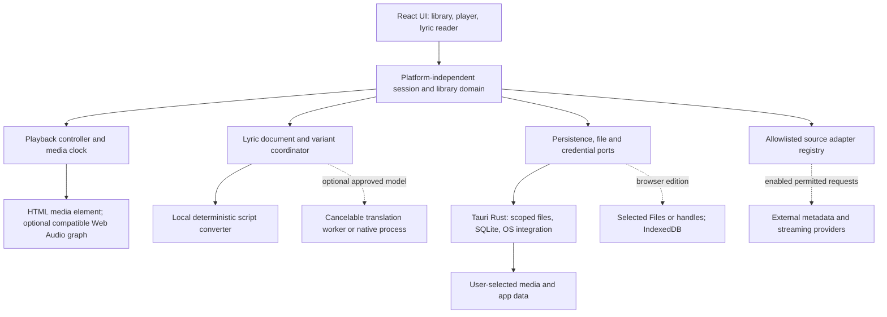

# Technical architecture

**Current desktop architecture proposal:** the user explicitly returned Lumaire to Windows/Tauri 2 + Rust, with React/TypeScript/Vite. This supersedes website-first delivery assumptions; [13](13-lumaire-web-provider-architecture.md) preserves that investigation as history. [14 Desktop audit](14-desktop-transition-audit.md) records reconciliation, current environment and blockers. No implementation or dependency installation is authorized in Phase 1; engine selection remains gated by Phase 2 tests.

Status: proposed design, **17 October 2026**. No implementation, build or dependency installation. Requirements: [02](02-prd.md); source restrictions: [05](05-source-feasibility.md); detailed lyric contracts: [06](06-lyrics-system.md); release risks: [08](08-licensing-risks.md).

## Recommendation and alternatives

Use an original **React + TypeScript shared UI/domain with a Tauri 2 Windows shell**, Rust-owned local access and SQLite persistence. Keep the domain independent of Tauri so a later static browser edition can substitute storage/file/network adapters. Version selection and lockfiles belong to the implementation phase, after license and compatibility checks.

| Option | Strength | Constraint / decision |
|---|---|---|
| Tauri + web UI | Local files/database and system integration; shared browser UI | Rust/MSVC/WebView2 prerequisites; codec/output behavior must be measured. Recommended desktop shell, not a guaranteed performance win |
| Browser/PWA only | Shareable URL, free static deployment, no native installer | File permission/reselection, CORS, storage eviction and mobile background constraints. Planned web edition; not equivalent to desktop |
| Electron | Mature Chromium/Node integration and consistent bundled engine | Bundled runtime and broader native surface; no evidence that this project needs it initially |
| Kotlin/Compose | Strong Android/shared-code path as BitChord demonstrates | Adds unfamiliar runtime/tooling and separate browser strategy; not selected for this Windows/web scope |

The workspace was empty at initial inspection and is not initialized as a Git repository. Node 24.15.0 and pnpm 12.11.2 were found. Phase 1.5's read-only check finds Visual Studio Build Tools 2022 17.14.36301.6 with the VC x86/x64 tools component and WebView2 application directories 155.0.4283.45/.62 at that earlier check. The current audit finds 155.0.4283.62, MSVC cl.exe 19.44.35211.0 and SDK Include/Lib/rc.exe 10.0.22621.0; see [14](14-desktop-transition-audit.md). Rust/Cargo are absent from PATH; the standard user rustc path checked is also absent. No build/link/SDK/codec certification follows from file presence. No installers ran. Follow [Tauri prerequisites](https://v2.tauri.app/start/prerequisites/) at a later-authorized setup milestone; see [validation](12-phase-1.5-validation.md).

## Component and trust boundaries

UI renders untrusted metadata/lyrics as text. Domain chooses track identity and queue transitions. Playback controller is the single owner of media state. Rust mediates native privileges and database access; React does not receive arbitrary file-read, database-SQL or shell-execution powers. Third-party pages never load inside a privileged application window. There is no required hosted backend, account service, transcoder or central music proxy. A scoped native media transport is conditional on Phase 2 evidence; no generic localhost URL proxy is proposed.

## Separate adapters and controlled native bridge

Original proposed contracts, not copied Nuclear SDK code. Source inspection and licensing boundaries are recorded in [14](14-desktop-transition-audit.md) and [13](13-lumaire-web-provider-architecture.md).

```mermaid
flowchart LR
  UI[React UI] --> Session[Session coordinator]
  Session --> Metadata[Metadata adapters]
  Metadata --> Intent[Recording intent]
  Intent --> Discover[Candidate discovery adapters]
  Discover --> Match[Matcher and explicit selection]
  Match --> Gate[Permission and capability gate]
  Gate --> Resolver[Replaceable resolver adapter]
  Resolver --> Bridge[Typed native command facade]
  Bridge --> Rust[Rust process supervisor]
  Rust --> Tool[Optional verified yt-dlp]
  Rust --> Ticket[Ephemeral media ticket]
  Ticket --> Playback[Playback controller and tested backend]
  Local[Scoped local assets] --> Playback
  Playback --> Clock[Actual media clock]
  Clock --> Lyrics[Original and supplied variant reader]
  Session --> DB[Rust-owned SQLite]
```

| Adapter | Contract / separation |
|---|---|
| Metadata search | Query/page → catalogue records with source IDs, attribution and recording hints; local index works offline. Neither audio resolution nor subprocess execution occurs here |
| Candidate discovery | Recording intent → bounded provider-bound candidates, canonical pages, duration/edition evidence and access status. Local exact assets bypass fuzzy discovery |
| Matcher | Prefer saved exact recording binding; compare artist credits, version/live/remix/cover markers and duration. Return reasons/ambiguity, not fabricated confidence probabilities. Provider access is checked before discovery as well as resolution |
| Resolver | Selected candidate ID → local reference or ephemeral media ticket with codec/container/protocol, required-header handling, expiry and capabilities. yt-dlp is one optional implementation, never a UI dependency |
| Playback backend | Ticket/reference → load/play/pause/seek and normalized clock/buffering/ended/error; owns a single active transport. Different engines stay behind this port |
| Registry | Bundled reviewed adapter ID/version, operations, runtime, permitted origins, terms-review date, health/backoff and disabled reason. No remote JavaScript plugin execution |

**Native facade proposals:** select/import media, query/update library, discover candidates, resolve one candidate, cancel job, inspect resolver status, open/release media ticket. Requests carry adapter ID, validated record ID, job ID and session generation. Rust owns an expiring candidate registry so a caller cannot replace an approved candidate with an arbitrary URL. UI never supplies executable paths, shell text, raw flags, environment variables or arbitrary SQL. Selecting a resolver binary is a distinct explicit settings operation, validated natively.

The native supervisor launches a verified absolute executable using an argument vector, never cmd/PowerShell interpolation. Build operation-specific arguments internally; disable external configuration, executable plugins, post-processing/exec hooks, cookie sources, automatic updates and remote-component retrieval. No download operation is exposed: structured metadata/URL resolution only, no saving media/subtitles/artwork or hidden prefetch. Ignore unsupported fields and bound JSON bytes, nesting, results and stderr before parsing/rendering. Exact supported switches are validated against the pinned version before Phase 2; this document is not a ready-to-run CLI recipe.

Use a restricted working directory/environment, approved network schemes/hosts and redirect validation. yt-dlp and any JS runtime are executable dependencies; input validation alone is not an OS sandbox. Review actual child-process/runtime permissions and filesystem side effects, including incidental caches, rather than claiming isolation. Proposed limits: one active resolver job, at most ten discovery results, 30-second wall deadline, bounded output and no stdin. Test these limits; tune explicitly if justified. Do not inherit browser cookies, user configuration, proxy secrets or plugin paths. Preserve Windows runtime essentials through a reviewed environment allowlist.

Cancellation must terminate the child process tree (evaluate Windows Job Objects), close pipes and release resources. A timeout and a superseded UI result are different events. Process exit and decoder errors become typed unavailable/timeout/cancelled/access-denied/upstream-changed/unsupported-format failures; raw stderr is redacted. On application exit terminate jobs. No retries for denied authentication/rights, missing executable or malformed output; transient retries have a total wall budget. Updates are explicit verified transactions with rollback, never yt-dlp self-update during playback.

Only the native layer holds signed URLs/required sensitive headers where practical; React receives an opaque ticket. Direct HTTPS media is allowed only if safe and compatible; headers unsupported by HTML audio may require a scoped native transport. Prefer an asset/custom protocol supporting Range where validated. If a loopback relay proves necessary, bind loopback only, authenticate per-session requests, use opaque scoped tickets, reject arbitrary URLs and validate redirects/SSRF, origin access, Range/206/416 and lifetime. Do not reproduce Nuclear's permissive relay unchanged. No media disk cache or transcoding is implied. Native HTTP can solve a transport restriction, not a content permission restriction.

Keep SQLite, local queue and lyric imports independent of resolver availability. Disabling/deleting yt-dlp leaves cold-start local playback and playlists functional with networking blocked. Remote items remain listed as unavailable; local items can still be selected. Secrets, signed URLs and object URLs are not durable identities.

## Playback and source contracts

The following describes proposed interfaces, not an existing provider API.

| Boundary | Input / output and invariants |
|---|---|
| Track identity | Internal track ID plus immutable source ID/source-record ID; metadata corrections are separate. Artist/title alone are not identity |
| Source capabilities | Search, metadata, audio, video-embed, seek, offline, download, processing and authentication as explicit capabilities; permission evidence and unknown/denied states accompany them |
| Search | Query, filters and cancellation token → paged candidates with source identity, duration/version and availability; debounce and bound concurrency |
| Resolve | Exact source-record ID and permitted quality → expiring media reference, codec/container if known, attribution, expiry, required auth and restrictions; never persist raw signed URLs as durable identity |
| Playback | Load, user-initiated play, pause, seek, gain/volume, repeat/shuffle; emits clock, buffering, ended and typed errors tagged with request/session generation |
| Library | CRUD through typed domain operations; all playlist mutations transactional; revisions prevent stale UI writes |
| Credentials | Provider-scoped secrets via OS credential storage on desktop; no application client secrets in browser bundles; browser OAuth only where an approved public-client flow exists |

Lifecycle: **idle → resolving → loading → ready/playing ↔ paused/buffering → ended**, with recoverable error and cancellation from each pending state. A track/session generation ID prevents an earlier request from replacing the current song. Only the playback controller handles ended once; history completion is idempotent. Resume after restart is paused.

On expiry, resolve the same recording once under a bounded retry policy. Honor Retry-After and quota shutdown; authentication/rights errors do not trigger endless retries. Do not silently substitute another song/source. Users may explicitly choose a different candidate and retain that correction.

Local playback uses a capability-scoped media reference to selected files, not base64 copies of entire tracks. Validate path scope, canonical paths and symlink/reparse-point behavior before exposure. Streaming stays direct to a permitted source when supported. An authenticated native fetch or scoped stream relay is conditional on provider permission and later threat/range/cancellation tests; it is not a way to evade access policy. Browser extension or hosted extraction proxy is not required by the baseline.

## Audio processing limits

Start with the WebView media element for decode/seek/transport; use actual media time for lyrics, not accumulated timers. Validate MP3/WAV/FLAC fixtures before advertising formats. WebView2, browser, OS codecs and output devices can differ. Record unsupported codec/container as a clear error rather than claiming universal support. [HTMLMediaElement](https://developer.mozilla.org/en-US/docs/Web/API/HTMLMediaElement).

Optional later Web Audio processing can provide EQ/gain/analyser/crossfade only when source access and CORS allow it. Bypass processing where unsupported; prevent clipping and avoid decoding a long library into memory. Gapless transitions, precise crossfade, high-resolution and bit-perfect output require separate measurements. Source FLAC does not establish lossless Bluetooth output. No FFmpeg bundle or DSP model is assumed. [Web Audio](https://developer.mozilla.org/en-US/docs/Web/API/Web_Audio_API).

## Data model and migration

Conceptual SQLite schema; no SQL or migration implementation exists yet. Use app-private database files, one serialized writer and transactional operations; consider a reviewed rusqlite binding on a background worker. Evaluate SQLite full-text indexing after baseline search measurements.

SQLite is preferred because ordered playlists, stable source/asset relations, corrections and crash-safe session updates benefit from transactions and constraints without a server. Plain JSON remains suitable for portable export, but is not the preferred live relational store. IndexedDB remains a future browser adapter rather than desktop authority. Binding, bundled-library choice and schema are proposals, not installed dependencies; Phase 2 tests only the minimal playlist/session round trip.

| Entity | Key fields / relations |
|---|---|
| tracks | UUID, normalized display metadata, duration, recording/version hints, created/updated revision |
| source_records | UUID, track FK, provider ID, provider record ID, canonical URL, access state, provenance/terms timestamp, attribution; unique provider+record |
| local_assets | UUID, source-record FK, scoped path/handle reference, size/mtime, optional content hash, codec, missing status; moved files require confirmation |
| playlists / playlist_items | Playlist UUID/name/revision; item UUID, playlist FK, source-record FK and ordered position; allow intentional repeated tracks |
| favorites | Entity kind+ID, timestamp; avoid assuming every favorite is an audio file |
| queue_items / session | Durable queue item IDs/order, active item, last position, shuffle seed and repeat; expired URLs excluded |
| lyric_documents / lyric_lines | Document UUID/revision, track/source-record binding, provenance/rights/parser/offset metadata; line IDs and optional times; authorized text only |
| lyric_variants / corrections | Source document hash+revision, engine/rules/model ID+version, language/script/scheme, mapped unit IDs, authorized generated/supplied text, user overrides |
| history_events | Unique playback-session/item/completion key, start/end/listening duration; local-only default; do not count seeked time as listened time |
| provider_state / settings | Enabled capabilities, quota/backoff timestamps, schema-tagged user preferences; secrets stored separately |

Foreign-key checks, indexes on source IDs/search/order, import size bounds and duplicate rules are required. Schema version migrations run transactionally after a backup; failure preserves a recoverable prior database. Portable exports carry format version and stable identities, not API secrets, signed URLs, machine-specific absolute paths by default or audio/lyrics that cannot be exported. Missing files stay visible with a relink action. Clear-history does not delete original media.

Phase 1.5 identity clarification: reimporting the same scoped file preserves one library asset and its corrections. Separate file copies stay distinct unless explicitly merged; intentional repeated playlist/queue entries always have unique item IDs. Portable relative references resolve only under a user-selected import root; filename similarity never silently relinks a missing file. [Acceptance protocol](12-phase-1.5-validation.md).

## Lyrics and TuneScript boundary

Keep source text and timestamps immutable; generated variants are a separate versioned layer. Translation and romanisation jobs run asynchronously, cancel on song/document changes, preserve line IDs and cannot change audio state. Workers get bounded plain-text input and no arbitrary file/network permissions. Cache only when authorized; cap by bytes and expose delete controls. Script conversion, phonetic romanisation and translation have different language/quality contracts. [06](06-lyrics-system.md) is authoritative.

TuneScript 1.3.2 is a YouTube Music browser extension with Gemini cloud processing and browser runtime/storage coupling. Its source was inspected at the user-provided location; no reusable-package or licence grant was established. Reserve an optional port taking identified text units and returning mapped results with provenance; independently implement the required local reader. No cross-extension messaging, cloud calls, model downloads or copied code are core prerequisites. See [Phase 1.5](12-phase-1.5-validation.md).

## Historical browser alternative — future optional work

Reuse UI/domain and parser rules; replace native file/database ports. Start with explicit user-selected Files and object URLs; File System Access handles are an optional supported-browser enhancement requiring permission revalidation. Store metadata/session in IndexedDB, handle quota and eviction, and revoke object URLs. Persisted library metadata is not persisted permission to reopen an arbitrary disk file. Show reselection/relink flows. [File System API](https://developer.mozilla.org/en-US/docs/Web/API/File_System_API).

Static hosting can use a provider subdomain without purchasing a domain. No SSR/server is needed for a private local library. Service-worker app-shell caching does not authorize music caching. Backend-only credentials and large translation models must not leak into the browser build. Do not promise mobile lock-screen/background parity until tested. Online CORS and embed restrictions must be rechecked per source.

## Security, privacy, accessibility and verification

Use strict CSP, least-privilege Tauri capabilities, selected-file scopes and validated commands. Restrict network schemes/hosts and redirects, reject credentials in URLs and unsafe local/internal destinations from remote adapters. Treat artwork, playlists and lyric files as untrusted inputs with length/type bounds. Do not execute remote plugins, render provider HTML, extract session cookies or expose MCP/MPD/LAN controls by default. [Tauri security](https://v2.tauri.app/security/), [capabilities](https://v2.tauri.app/security/capabilities/).

Local history by default; disclose provider requests and make external history/translation sharing opt-in. Logs must redact paths, tokens, full lyrics and signed query strings by default. Named controls, visible focus, high-contrast modes, reduced motion and RTL are part of [UX](07-ui-ux.md), not a final cosmetic pass.

Later verification: domain/parser/rights-gate unit tests; SQLite migration/import/recovery tests; synthetic provider timeout/429/expiry tests; Playwright shared browser-shell journeys; real WebView2 Windows audio/device/manual screen-reader checks. A passing Chromium browser test does not certify Tauri native behavior. See [roadmap](09-roadmap.md). Proposed dependency licenses have a preliminary table in [08](08-licensing-risks.md); exact versions and transitive audit are pending.
