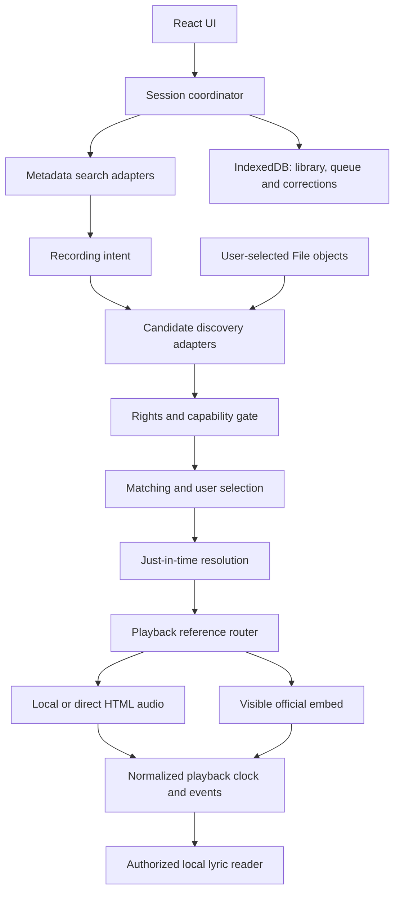

# Lumaire: browser provider investigation

17 October 2026, Asia/Kolkata. **Historical website-first investigation: React, TypeScript and Vite.** The user has since explicitly returned Lumaire to Windows desktop; [14](14-desktop-transition-audit.md) and [04](04-architecture.md) are current. The findings and WEB-01 proposal below retain their original scope, not current delivery authority. No code, dependency installation, extraction, media playback, provider registration or deployment was performed.

**Conclusion:** independently reproduce Nuclear's separation of metadata, candidates, resolution and playback. Use a browser media backend for local/permitted direct audio and a separate official-embed backend. Nuclear's native yt-dlp, HTTP bridge and loopback media proxy are not available to an ordinary website. A browser-only player is feasible; unrestricted, audio-only mainstream streaming without subscriptions, ads, helpers or infrastructure is not established.

## 1. What Nuclear actually does

Official documentation and selected public source files were inspected. These are static findings, not new execution evidence. Links below use mutable `master`; retrievals carry different cache dates. An attempted pinned-commit retrieval failed, so this is not a single-commit reproduction or certification of the installed 1.51.2 binary. Prior installed-app evidence remains in [11](11-installed-nuclear-investigation.md).

| Layer | Documented/source behavior | Independent browser equivalent |
|---|---|---|
| Plugins and hosts | Installed manifest/entrypoint are read from disk; code is compiled/read and evaluated with `new Function`, an allowed-module map and injected host APIs. Bootstrap loads the registry and enables saved plugins; providers register capabilities and active selections | Reviewed adapters bundled with the website. No runtime installation, arbitrary remote JavaScript, copied SDK or executable plugin store |
| Metadata | Searches artists/albums/tracks/playlists and fetches details; IDs remain provider-specific. Capabilities control available operations; a metadata source may require a paired streaming provider | Local index plus separately approved metadata adapters. Metadata is never proof of playable audio or permission to mix catalogues |
| Candidate discovery | `searchForTrack(artist,title,album?)`; optional `searchForTrackV2(track)` receives richer recording information. Returns possible recordings, not guaranteed fresh audio URLs | Candidate objects with provider/recording identity, version/duration evidence, availability and match reasons |
| Stream resolution | `getStreamUrl(candidateId)` or optional V2 full-candidate method. `streamingHost.ts` prefers V2, reuses fresh streams, timestamps new resolutions and marks failures after bounded attempts | Resolve the selected candidate just before use; return a typed playback reference, including embed IDs rather than forcing every source into an audio URL |
| Queue orchestration | `StreamResolution` caches candidates, tries the first nonfailed candidate and advances after failures; abort checks prevent superseded results from mounting. Signals shown here are not passed through provider method signatures | Cancellation-aware contracts plus generation checks. Keep errors and recording corrections explicit rather than silently switching to an alternate edition |
| yt-dlp host | SDK delegates to host; TypeScript host invokes Tauri commands. Rust launches the native executable, parses search/stream JSON and returns URL/codec/duration | Not browser-native. Requires an optional installed helper or server with an appropriate process runtime and separately permitted source access |
| Native HTTP/media bridge | Plugin HTTP requests use native `http_fetch`. `AudioSourceFactory` sends non-HLS stream URLs through a loopback server; Rust forwards Range requests/media headers and adds CORS headers | Direct authorized browser-accessible media or official embed. There is no equivalent automatic native proxy in a static Vite site |
| Audio engine | `Sound.tsx` owns an HTML audio element and composes load, seek, status, HLS and MSE hooks. Source conversion selects an MSE path for some MP4 audio. Playback manager coordinates queue/store/events | Independently written HTMLMediaElement controller first. HLS/MSE and DSP only when browser support, access and permissions are verified |

Evidence: [plugin docs](https://docs.nuclearplayer.com/nuclear/plugins/plugin-system), [loader](https://github.com/nukeop/nuclear/blob/master/packages/player/src/services/plugins/PluginLoader.ts), [bootstrap](https://github.com/nukeop/nuclear/blob/master/packages/player/src/services/plugins/pluginBootstrap.ts), [API assembly](https://github.com/nukeop/nuclear/blob/master/packages/player/src/services/plugins/createPluginAPI.ts), [provider registry](https://github.com/nukeop/nuclear/blob/master/packages/player/src/services/providersHost.ts), [metadata docs](https://docs.nuclearplayer.com/nuclear/plugins/metadata), [metadata host](https://github.com/nukeop/nuclear/blob/master/packages/player/src/services/metadataHost.ts).

Streaming contracts: [official two-phase documentation](https://docs.nuclearplayer.com/nuclear/plugins/streaming), [SDK types](https://github.com/nukeop/nuclear/blob/master/packages/plugin-sdk/src/types/streaming.ts), [host](https://github.com/nukeop/nuclear/blob/master/packages/player/src/services/streamingHost.ts), [candidate cache](https://github.com/nukeop/nuclear/blob/master/packages/player/src/services/streamResolution/candidateSource.ts), [orchestration](https://github.com/nukeop/nuclear/blob/master/packages/player/src/services/streamResolution/streamResolution.ts).

Desktop bridge and playback: [yt-dlp docs](https://docs.nuclearplayer.com/nuclear/plugins/ytdlp), [TS host](https://github.com/nukeop/nuclear/blob/master/packages/player/src/services/ytdlpHost.ts), [Rust commands](https://github.com/nukeop/nuclear/blob/master/packages/player/src-tauri/src/ytdlp.rs), [HTTP docs](https://docs.nuclearplayer.com/nuclear/plugins/http), [source conversion](https://github.com/nukeop/nuclear/blob/master/packages/player/src/services/streamResolution/audioSource.ts), [Rust stream server](https://github.com/nukeop/nuclear/blob/master/packages/player/src-tauri/src/stream_server.rs), [Sound](https://github.com/nukeop/nuclear/blob/master/packages/hifi/src/Sound.tsx), [loader hook](https://github.com/nukeop/nuclear/blob/master/packages/hifi/src/hooks/useAudioLoader.ts), [HLS hook](https://github.com/nukeop/nuclear/blob/master/packages/hifi/src/hooks/useHlsSource.ts), [MSE hook](https://github.com/nukeop/nuclear/blob/master/packages/hifi/src/hooks/useMseSource.ts), [playback manager](https://github.com/nukeop/nuclear/blob/master/packages/player/src/services/playback/playbackManager.ts).

Two useful qualifications: the SDK's yt-dlp `available` getter establishes host configuration, not an end-to-end extraction success. The inspected host's retry helper counts total attempts, so a configured value of three is not evidence of four attempts. Hook snapshots differ in signatures; internal MSE implementation was not fully recovered. No bit-perfect, gapless or universal browser-compatibility claim follows.

## 2. Proposed Lumaire architecture

These are original design contracts, not copied SDK interfaces or implementation code.

| Boundary | Input → output / invariant |
|---|---|
| Adapter registry | Trusted adapter ID/version, supported runtime, approved origins, auth mode, terms-review date and declared operations. Capabilities include search, discover, resolve, seek, clock, offline, DSP and visible-player requirement. Unknown permission disables that operation |
| Metadata search | Query/categories/page/cancellation → normalized records plus original source IDs and attribution. Local search works with every external adapter disabled. A local file or approved same-catalogue record can bypass fuzzy discovery |
| Recording intent | Internal library ID, original metadata provider/record ID, title/artists/version, duration and optional recording identifier. Preserve unknown values; do not equate identical titles with identical recordings |
| Discovery | Intent + explicitly enabled source → candidate IDs with canonical source page, uploader/artist evidence, edition, duration, restrictions and source-specific provenance. Candidate discovery is distinct from fetching media bytes |
| Matching | Exact source/recording binding first; otherwise compare complete artist credits, meaningful live/remix/cover/version labels and duration. Return match reasons and ambiguity, not an invented confidence probability. Wrong editions remain visible/rejected; user correction binds a specific provider ID |
| Resolution | Selected provider-bound candidate + cancellation → local-file reference, permitted HTTPS media reference, or official embed descriptor. Include expiry, access state, attribution and capabilities. Route by candidate's provider, not a changing global active provider |
| Playback | One active backend; normalized load/play/pause/seek/time/duration/buffering/ended/error events. Direct audio owns its element; embed owns its official player. Never play both simultaneously. Ad/error/unknown-clock states must not manufacture lyric progress |
| Persistence | Store stable record IDs, local metadata, queue and corrections in IndexedDB. Do not persist signed URLs, arbitrary cookies or object URLs as reopenable files. File reselection/relink is a normal browser state; persistent handles are optional enhancements |

Every operation is bound to a session generation. Abort fetches where supported; ignore late embed/provider events after switching; unload the previous backend and revoke object URLs only when no longer used. Resolve on user intent to play, not every search result. Refresh the **same** expired recording under bounded retries; 401/403, rights denial or quota exhaustion must not trigger hidden cross-source substitution. Keep metadata, resolved-media and lyric caches separate.

For embeds, resolution yields a provider/video ID and approved player configuration, **never a scraped stream URL**. Clock units normalize to milliseconds (YouTube reports seconds; SoundCloud widget position uses milliseconds). A lyrics pane sits beside a required visible player rather than covering it. Independent local text does not grant rights to synchronize/display arbitrary commercial lyrics.

## 3. Browser boundaries that affect the design

- **No native process privileges:** React/TypeScript run in the browser; Vite builds static assets. A Vite development proxy, service worker or WebAssembly module does not grant native subprocess/file/network privileges or create a production backend. No Tauri invoke, arbitrary filesystem paths or desktop yt-dlp host exists in an ordinary page.
- **Three access tests:** browser metadata `fetch` needs suitable CORS; a direct media element can sometimes play cross-origin resources without script-readable bytes; Web Audio inspection/processing has stricter origin rules and can output silence for a tainted media source. Do not enable `crossOrigin`/EQ blindly. [HTML media standard](https://html.spec.whatwg.org/multipage/media.html), [Web Audio security](https://webaudio.github.io/web-audio-api/#MediaElementAudioSourceNode-security).
- **Separate playback modes:** HLS/MSE fetching needs permitted segment/key access, CORS and codec support. Embeds expose controls/events, not raw samples; do not promise EQ, crossfade, offline storage or audio extraction for them. Direct playback may still fail due to authentication, redirects, expiry, MIME type, server range behavior or region.
- **Browser lifecycle:** user gesture may be needed to start playback; catch play rejection and offer a visible retry. File objects/object URLs are session-bound references; storage can be evicted. Background/lock-screen continuity is device-specific. [File API](https://w3c.github.io/FileAPI/), [audio behavior](https://developer.mozilla.org/en-US/docs/Web/HTML/Reference/Elements/audio).

## 4. Source feasibility matrix

**D = documented browser mechanism, not playback verified here; C = conditional permission/access; X = unsuitable for this MVP.** No source below was played during this investigation; none establishes unrestricted mainstream coverage.

| Source / mode | Browser route and cash requirement | Restrictions / missing evidence | Recommendation |
|---|---|---|---|
| User-selected lawful files | File → object URL → audio; no key/subscription/server | Codec/reselection/persistence tests; no implied redistribution rights | D: required foundation |
| Individually creator-authorized direct audio | HTTPS audio from a permitted host; ₹0 only where the existing hosting grant covers it | Verify recording/composition/art/lyric permission, hotlinking, CORS/ranges/expiry and bandwidth terms per asset | C: direct-stream fixture candidate; no generic arbitrary-URL catalogue |
| YouTube official IFrame API | Visible provider player for known video IDs; no paid account or Data API search key needed for that route | Retain player, ads and restrictions; no audio separation, hidden/background-player feature or downloads. Embedding/region/age errors can occur | D/C: first external **experiment**, as visible video mode; not an audio-only subscription replacement |
| SoundCloud official widget | Official iframe plus asynchronous control/position API; distinct from custom API credentials | Current API terms restrict alternative aggregation/mixed-service listening absent explicit licensing. Widget existence alone does not clear Lumaire's intended multi-source use | C: defer until widget-specific use/terms are confirmed; no default mixed queue |
| SoundCloud custom API | Documented API; new app credentials require Artist Pro | Paid registration conflicts with strict ₹0; uploader rights and aggregation restrictions remain | X for mandatory integration |
| Jamendo official API | Documented stream field; noncommercial use and registered client ID | Earlier public credential-disclosure ambiguity remains; prior metadata probe failed before status. Browser playback, CORS and exact track rights unverified | C: optional later candidate, not cleared public adapter |
| Audius official API | Documented free key tier: 10 requests/s, 500,000/month; frontend key differs from secret bearer token | Full API terms page still inaccessible; per-track gates/licences, CORS and playback untested | C: do not recommend production inclusion yet |
| Spotify Web Playback SDK | Official browser SDK | Spotify Premium account required for playback; developer/platform restrictions also apply. Metadata is not a free-stream entitlement | X for no-subscription promise |
| Nuclear-style YouTube extraction | Native resolver or server, then media access/proxy | No ordinary browser executable host; source permission not established; expiry/region/bot checks and proxy maintenance | X as the authorized ₹0 browser foundation |

Primary checks: [YouTube IFrame API](https://developers.google.com/youtube/iframe_api_reference), [YouTube policies](https://developers.google.com/youtube/terms/developer-policies), [SoundCloud widget](https://developers.soundcloud.com/docs/api/html5-widget), [SoundCloud API terms](https://developers.soundcloud.com/docs/api/terms-of-use), [registration](https://developers.soundcloud.com/docs/api/register-app), [Jamendo terms](https://devportal.jamendo.com/api_terms_of_use), [Audius SDK](https://docs.audius.co/sdk/), [unretrieved Audius terms](https://audius.co/legal/api-terms), [Spotify SDK requirements](https://developer.spotify.com/documentation/web-playback-sdk/tutorials/getting-started). [Earlier source investigation](05-source-feasibility.md) retains additional candidate detail.

YouTube search is a separate integration from embedding known IDs; [current quota guidance](https://developers.google.com/youtube/data/determine_quota_cost) documents a default search limit of 100 calls/day. Do not scrape search, pool keys or equate iframe playback with unlimited search access. Search can initially be local/curated links and user-supplied video URLs, validated into provider IDs.

## 5. Runtime and ₹0 budget comparison

| Deployment | What it enables | Cash/operational reality | Decision |
|---|---|---|---|
| Browser-only static website | Local library, authorized direct media, approved official embeds and CORS-enabled metadata | Existing PC/browser and free static allocation; no required API/inference/media server. Third-party/player limits still apply | Preferred initial Lumaire architecture |
| Website + local helper | Native resolver/networking on the listener's PC, possibly local range relay | Can have zero hosting cash, but installs, updates, authentication and OS support reintroduce trust friction. Chrome local-network permissions and browser differences require testing | Optional later; contradicts frictionless no-install entry if required |
| Website + metadata/resolution backend | Keeps true secrets server-side, manages permitted API requests and emits playback references | Small responses may fit a free tier, but not every edge runtime can execute yt-dlp. Provider rights, rate/CPU/time limits and source/client IP binding still matter | Only after a specific permitted need and host plan are validated |
| Website + audio proxy/backend | Relays media and ranges to browsers | Carries media bandwidth and concurrency. At 128 kbit/s, one listening hour is about 57.6 MB payload; 1,000 hours about 57.6 GB, before overhead. Free hosting is not verified unlimited capacity | Exclude from ₹0 MVP foundation |

[Vite deployment guidance](https://vite.dev/guide/static-deploy) supports a static build. [Cloudflare Pages limits](https://developers.cloudflare.com/pages/platform/limits/) currently include 500 free builds/month and 25 MiB per asset; this supports considering an app-shell host, not a music archive or native extraction server. A separate backend needs its own runtime/terms review. [Chrome local-network guidance](https://developer.chrome.com/blog/local-network-access) makes clear that loopback connections are permission-sensitive; do not assume every HTTPS→localhost combination succeeds or fails identically.

Any helper must bind loopback only, require explicit pairing and origin checks, validate endpoints/redirects, and never expose arbitrary shell execution or an open proxy. A backend requires comparable URL/SSRF, credential and request-budget controls. These are design requirements; no helper/server was built or security-tested. Neither deployment changes content permissions.

## 6. Licensing boundary

Nuclear's [repository licence](https://github.com/nukeop/nuclear/blob/master/LICENSE) is AGPL-3.0; the inspected [plugin SDK manifest](https://github.com/nukeop/nuclear/blob/master/packages/plugin-sdk/package.json) explicitly says AGPL-3.0-only. Do not import its SDK, hifi, UI components or source snippets as an assumed permissive shortcut. JavaScript delivered to browsers is conveyed software; a covered derivative requires applicable licence/notices/corresponding-source compliance, and AGPL section 13 addresses source offers for applicable modified network interaction. Putting copied code behind an API does not automatically resolve those obligations.

Independently authored contracts/behavior based on the general separation above avoid deliberately copying Nuclear's implementation; this is not a blanket ruling about derivation, compatibility or patents. Review exact dependencies and assets before release. yt-dlp's [own licence](https://github.com/yt-dlp/yt-dlp/blob/master/LICENSE) is separate, with bundled-component obligations to check if ever distributed; it grants no recording/service rights. No Nuclear code/package, provider credential or media was copied into Lumaire.

## 7. Recommended next experiment — WEB-01

**Specify now; implement only after a later instruction.** One minimal browser page, no account system, library crawler, backend or helper:

1. Baseline: one self-authored/cleared local MP3 or PCM WAV and its supplied three-line LRC. Verify user-initiated audible playback, pause, seek, exact recording binding and lyric clock. Record file hash/permission/browser/OS.
2. External mode: one rights-holder-authorized, embeddable YouTube video with a known ID, using the official visible player. Retain controls/branding/ads and at least the documented 200×200 viewport; recommend 480×270 where layout permits. No search API, extracted URLs or provider SDK installation is needed for this test.
3. Normalize official player time/state into the same reader interface using separate supplied, authorized lyric text. Check pause/seek/buffering/end and one source switch; prevent simultaneous sound and stale updates. Do not assume reliable ad-state detection or inspect cross-origin player internals. If clock state cannot be trusted, disable synchronized highlighting for that mode.
4. On desktop Chrome/Edge and Firefox, record 30 seconds of **audible** output, one forward/backward seek and final event ownership. Check an allowed and denied/missing video; classify errors 100/101/150 and client-identification error 153. Verify that hiding/navigating away from the required visible player does not create a background-player feature. Use a real served origin/referrer; a `file://` or stripped-referrer failure does not prove embedding is unavailable.
5. Pass only the modes actually observed. Mobile background playback, catalogue search, direct streaming APIs, full lyric accuracy and offline remote music remain outside this experiment. If the visible-video UX is unacceptable, stop the YouTube route and evaluate a cleared direct-audio asset rather than silently adding extraction.

No WEB-01 implementation or playback was executed here. Success would validate the browser/provider boundary—not all catalogue rights, scale, lyric accuracy or a free replacement for premium music services.
